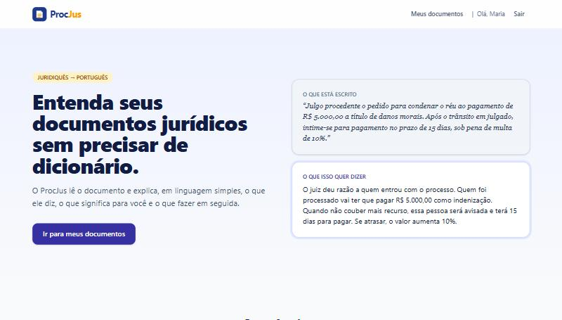
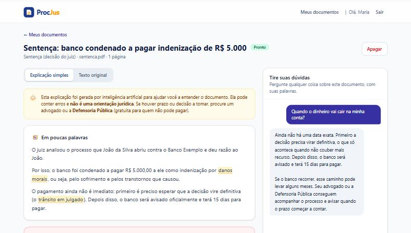
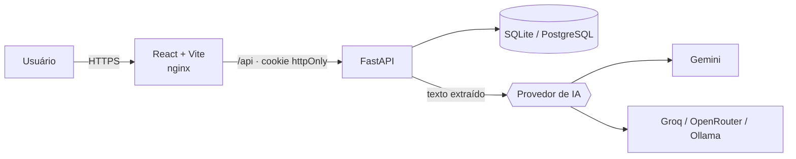

<h1 align="center">⚖️ ProcJus</h1>
<p align="center"><b>Documentos jurídicos traduzidos para a linguagem do dia a dia.</b></p>

<p align="center">
  
  
  
  
  
  
</p>

Quem recebe uma intimação, uma sentença ou um contrato e não é da área do Direito costuma travar no
"juridiquês". O **ProcJus** lê o PDF e devolve uma explicação em linguagem simples: o que o documento diz,
quem é quem, o que foi decidido, **quais prazos correm** e o que a pessoa pode fazer em seguida. Depois disso,
é possível conversar com o documento e perguntar qualquer coisa com as próprias palavras.





> As imagens mostram um processo fictício, usado apenas como demonstração.

## Funcionalidades

- **Tradução popular**: resumo em linguagem simples, partes envolvidas, decisão, pontos principais e próximos passos.
- **Prazos em destaque**: os prazos aparecem num bloco separado, com destaque visual, para não passarem despercebidos.
- **Glossário interativo**: os termos técnicos são destacados no texto original e no resumo. Ao passar o mouse (ou navegar com Tab), aparece a explicação.
- **Chat sobre o documento**: as respostas se baseiam no texto do documento, com histórico salvo.
- **Contas de usuário**: cadastro e login com senha protegida (Argon2), sessão em cookie `httpOnly` e histórico de documentos por usuário.
- **IA plugável**: Google Gemini e qualquer API compatível com a OpenAI (Groq, OpenRouter, Ollama…), trocados pelo `.env`. Os dois têm camada gratuita.
- **Documentos longos**: quando o texto passa do limite do modelo, ele é dividido em trechos, cada trecho vira anotações e as anotações formam a análise final (map-reduce).

## Arquitetura



**Fluxo do upload**

1. O backend valida o arquivo (tamanho e assinatura `%PDF`) e extrai o texto com `pypdf`. **O PDF é descartado**: só o texto fica guardado.
2. A API responde `202 Accepted` na hora e a análise roda em segundo plano.
3. O frontend consulta o status até ficar `ready`. Se der `error`, é possível reprocessar.
4. A IA responde num **JSON validado por Pydantic**. Se o JSON vier inválido, o próprio modelo é chamado de novo para corrigi-lo.

### Decisões de segurança e privacidade

| Ponto | Como foi tratado |
|---|---|
| Senhas | Hash com **Argon2id** e senha mínima de 8 caracteres, com letras e números |
| Sessão | JWT em cookie `httpOnly` + `SameSite=Lax`, inacessível ao JavaScript (protege contra roubo via XSS) |
| Força bruta | Bloqueio temporário após 5 tentativas de login erradas por e-mail |
| Enumeração de contas | Mesma mensagem e mesmo tempo de resposta para e-mail inexistente e senha errada |
| Acesso a documentos | Cada documento só é acessível pelo dono. Para os outros, a API responde 404, sem revelar que ele existe |
| Dados pessoais | O PDF original não é armazenado e a pessoa pode apagar documento e conversa quando quiser |
| Aviso legal | Lembrete de que a IA não substitui advogado nem Defensoria Pública, no cadastro e em cada documento |

## Como rodar

### Com Docker

```bash
cp backend/.env.example backend/.env   # ajuste SECRET_KEY e o provedor de IA
docker compose up --build
```

Acesse http://localhost:8080.

### Em desenvolvimento

**Backend** (Python 3.11+)

```bash
cd backend
python -m venv .venv
.venv/Scripts/activate          # Linux/macOS: source .venv/bin/activate
pip install -r requirements-dev.txt
cp .env.example .env
uvicorn app.main:app --reload   # http://localhost:8000/docs
```

**Frontend** (Node 20+)

```bash
cd frontend
npm install
npm run dev                     # http://localhost:5173 (repassa /api para a porta 8000)
```

### Escolhendo o provedor de IA

Por padrão, `LLM_PROVIDER=fake` devolve respostas simuladas, o que permite rodar o app sem nenhuma chave.
Para ter a tradução de verdade:

| Provedor | Configuração no `backend/.env` | Onde conseguir a chave |
|---|---|---|
| Google Gemini | `LLM_PROVIDER=gemini` e `GEMINI_API_KEY=...` | [Google AI Studio](https://aistudio.google.com/apikey) |
| Groq (Llama) | `LLM_PROVIDER=openai_compat` e `OPENAI_COMPAT_API_KEY=...` | [Groq Console](https://console.groq.com/keys) |
| Ollama (local) | `LLM_PROVIDER=openai_compat` e `OPENAI_COMPAT_BASE_URL=http://localhost:11434/v1` | Não precisa de chave |

> **Privacidade:** nas camadas gratuitas, alguns provedores podem usar o conteúdo enviado para melhorar seus
> modelos. Para documentos reais com dados sensíveis, prefira um plano pago com retenção zero ou um modelo local (Ollama).

## Testes

```bash
cd backend && pytest        # 17 testes: autenticação, isolamento entre usuários, upload, chat, map-reduce...
cd frontend && npm run lint && npm run build
```

O CI (GitHub Actions) roda lint, formatação e testes do backend, além do lint e do build do frontend, a cada push.

## Estrutura

```
backend/
  app/
    llm/          # provedores de IA (Gemini, compatível com OpenAI, fake) atrás de uma interface única
    routers/      # rotas de auth e documentos
    services/     # extração de PDF, prompts e orquestração da análise e do chat
    security.py   # Argon2, JWT, limite de tentativas de login
  tests/
frontend/
  src/
    pages/        # landing, login/cadastro, painel, documento
    components/   # chat, glossário interativo, layout
```

## Próximos passos

- [ ] OCR para PDFs escaneados (Tesseract)
- [ ] Migrações com Alembic e PostgreSQL em produção
- [ ] Fila de tarefas (RQ/Celery) para processar vários documentos em paralelo
- [ ] Respostas do chat em streaming
- [ ] Recuperação de senha por e-mail

## Histórico

A primeira versão (2024, Flask + Bard) está preservada na tag [`v1`](../../tree/v1).

---

<p align="center">Feito por <a href="https://www.linkedin.com/in/luizhltdev">Luiz Teixeira</a></p>
